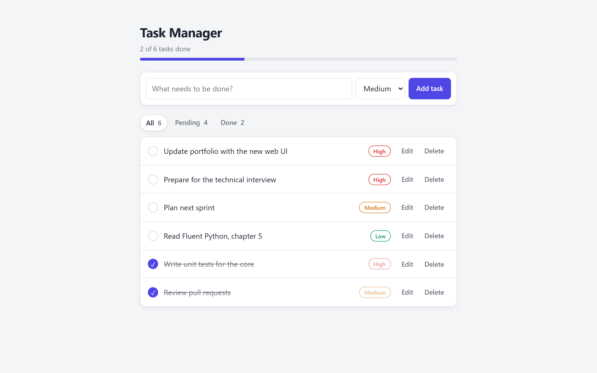

# Task Manager 📝

A small task manager with a **web interface** and a **command-line interface**,
both built on the same business-logic layer and backed by a local SQLite database.

The goal of the project is to stay simple and readable while following good
practices: separation of concerns, input validation, error handling and tests.

## Screenshot



A [mobile screenshot](docs/screenshot-mobile.png) is also available.

## Features

- Add, edit and delete tasks (deleting asks for confirmation)
- Mark tasks as done or back to pending
- Priority per task: low, medium or high (shown as colored badges)
- Filter by status: all, pending or done, with counters
- Progress bar, empty states and clear validation messages (e.g. blank titles)
- Responsive layout with automatic dark mode
- Data persists between runs in SQLite
- Databases from the first version of the project are migrated automatically
- A corrupted database file is moved aside instead of crashing the app

## Technologies

- Python 3.10+
- [Flask](https://flask.palletsprojects.com/) for the web interface (HTML, CSS and a few lines of JavaScript)
- SQLite (`sqlite3` from the standard library)
- [pytest](https://pytest.org/) for automated tests

## Project structure

```
task_manager/
├── core.py          # Business logic: TaskManager, validation, SQLite storage
├── cli.py           # Terminal interface (uses core only)
└── web/
    ├── app.py       # Flask routes (uses core only)
    ├── templates/   # Jinja templates
    └── static/      # CSS and JavaScript
tests/
├── test_core.py     # Business-logic tests
└── test_web.py      # Web route tests
```

Both interfaces only call `TaskManager`; neither knows anything about SQL.

## Installation

Requires **Python 3.10 or newer**.

```bash
git clone https://github.com/sugixp/task-manager.git
cd task-manager

python -m venv .venv
# Windows
.venv\Scripts\activate
# macOS / Linux
source .venv/bin/activate

pip install -r requirements.txt
```

## Running

### Web interface

```bash
python -m task_manager.web.app
```

Then open <http://127.0.0.1:5000>. You can also use the Flask CLI:

```bash
flask --app task_manager.web.app run
```

Debug mode is **off** by default. To enable it during development, set
`FLASK_DEBUG=1` before running the command.

### Terminal interface

```bash
python -m task_manager.cli
```

```
=== Task Manager ===

1. Add task
2. List tasks
3. Edit task
4. Toggle done / pending
5. Delete task
6. Quit

Choose an option: 2
Show (all/pending/done) [all]:

=== Your tasks (all) ===
[ ] 3. Update portfolio (high)
[ ] 2. Read a book (low)
[x] 1. Study Flask (medium)
```

## Configuration

| Environment variable       | Purpose                                         | Default                         |
| -------------------------- | ----------------------------------------------- | ------------------------------- |
| `TASK_MANAGER_DB`          | Path to the SQLite database file                | `tasks.db` in the project root  |
| `TASK_MANAGER_SECRET_KEY`  | Key used to sign the web session (flash messages) | Random key generated at startup |
| `FLASK_DEBUG`              | Set to `1` to enable Flask debug mode           | Off                             |

The database file is local user data and is ignored by Git.

## Running the tests

```bash
pip install -r requirements-dev.txt
python -m pytest
```

## Regenerating the screenshots

The images in `docs/` are generated with [Playwright](https://playwright.dev/python/)
using a temporary database with sample tasks (your `tasks.db` is not touched):

```bash
pip install -r requirements-dev.txt
python -m playwright install chromium
python scripts/screenshot.py
```
